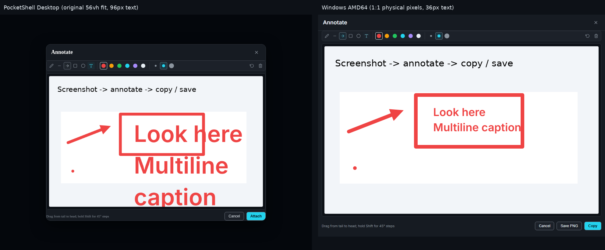
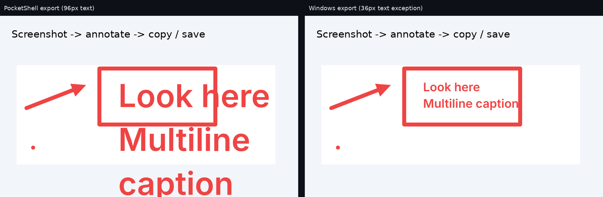

# PocketShell annotate parity

The editor embeds PocketShell's actual `DoodleCanvas.vue`, `doodlePaint.ts`, `doodleModel.ts`, `useDoodleText.ts`, geometry, icons, design tokens, and Inter Variable fonts. The native tray process prewarms WebView2 before capture. [Vendored source provenance](../../ui/vendor/provenance.json) records the upstream commit and original file hashes; [sync-doodle-ui.py](../../scripts/sync-doodle-ui.py) reapplies the host adaptations.

Intentional differences, approved by the intake:

- Captions remain 36px, including the default weight. Font family, weight 600, wrapping, and editing follow PocketShell.
- The captured image opens at 1:1 physical pixels over the selected screen region. PocketShell's 56vh preview fit and 2048px working-resolution cap do not apply. Only captures larger than the monitor's work area are fit.
- Copy and Save PNG replace attachment staging. Their buttons use the component's footer styles.
- A selection near the top edge places the attached toolbar beneath the image. The toolbar follows OS DPI scaling while the image retains its physical dimensions.

## Screenshot proof

The reference comes from the real PocketShell headless harness. The Windows images come from the published single-file EXE's integration tests on native GitHub AMD64 and ARM64 runners. They use the same 900×550 backdrop and the same arrow, rectangle, pen dot, and multiline caption at the same image coordinates. Each app uses its default stroke weight 12. The reference caption is 96px; ours remains 36px by request.

The side-by-side images retain each screenshot's original pixels. The reference's smaller sheet is its 56vh preview, not a different capture size. The headless Linux reference has a serif fallback in outer title/hint text; its canvas, tokens, and toolbar come from the real components. Both exported PNGs are 900×550.

Additional views: [Windows caption editing](windows-amd64-editing.png), [Windows discard guard](windows-amd64-guard.png), [PocketShell caption editing](pocketshell-editing.png).

## Verification

[Windows and browser CI](https://github.com/alexeygrigorev/win-screenshot-annotator/actions/runs/40333654762) verifies the implementation. [Run metadata](windows-ci.json) records the source SHA, jobs, steps, and conclusions. Real hotkey-to-painted-editor timing: AMD64 331ms; ARM64 340ms. Warm region-image presentation: AMD64 107ms; ARM64 91ms.

- [AMD64 integration results](windows-amd64-results.txt) and [real-hotkey timing](windows-amd64-hotkey-startup.txt).
- [ARM64 integration results](windows-arm64-results.txt) and [real-hotkey timing](windows-arm64-hotkey-startup.txt).
- Browser CI verifies drawing, editing, undo, clear, the discard guard, Shift snapping, font loading, and a 150% renderer case: 900×550 physical image pixels with a 36px physical toolbar button.
- The Windows startup test launches without arguments, checks no visible window and zero captures, checks the tray and registered hotkey, then launches a second copy and checks that it exits while the first stays alive and shows a balloon.
- The real-hotkey measurement injects Ctrl+Alt+F into the tray process and measures its handler through desktop capture and two animation frames after showing the editor. It includes the 180ms DWM capture delay. Human region-selection time is excluded from region-to-editor measurements.
- Native placement checks assert 900×550 physical pixels at screen origin (60,160), plus a 200×150 top-right selection with attached chrome beneath it. The available native CI monitors report 96 DPI. The 150% renderer test supplements these checks; it does not claim hardware coverage of mixed-DPI monitors.
- Publishing asserts exactly one EXE, checks embedded icon sizes, and runs the integration tests against that EXE for both architectures. The existing optional signing and release pipeline is retained.

## Differences 1–18

| Row | Status | Evidence |
| --- | --- | --- |
| 1 Theme | Fixed | Vendored tokens and DoodleCanvas styles; both Windows screenshots. |
| 2 Frame | Fixed, with selection placement | Annotate header, Feather close icon, original footer, and native placement checks. |
| 3 Toolbar layout | Fixed | Original toolbar template/CSS: groups, separators, spacer, right-aligned Undo/Clear. |
| 4 Tool buttons | Fixed | Original AppIcon geometry and active styles; six-tool native assertion. |
| 5 Tool set | Fixed | Original six tools, Undo, Clear; app actions in the footer. |
| 6 Colours | Fixed | Native assertion checks all six rendered RGB values in order. |
| 7 Weights | Fixed | Original WIDTHS 6/12/24, middle default; native default and control assertions. |
| 8 Stroke rendering | Fixed | Original Canvas2D painter, quadratic pen smoothing, round caps; exported dot assertion. |
| 9 Arrowhead | Fixed | Original shared arrow geometry and painter; same arrow coordinates in both exports. |
| 10 Typography | Fixed, approved size exception | Bundled Inter Variable loaded before capture; native assertions for 36px and weight 600. |
| 11 Text editing | Fixed | Original transparent textarea; native multiline commit, reopen, and edit-undo checks. |
| 12 Selection/move | Fixed / preserved | Original component has no selection or move tool. |
| 13 Sheet | Fixed, approved placement override | Physical size/origin assertions, edge case, source-resolution export, and 150% renderer check. |
| 14 Hints | Fixed | Original component's state-dependent footer hints. |
| 15 Shortcuts | Fixed | Original shortcut registry and text handler; native Ctrl+Z/Escape/Ctrl+Enter and browser Shift checks. |
| 16 Close guard | Fixed | Original red-tinted confirmation; native first/second Escape and repeated window-close checks. |
| 17 Output | Fixed, standalone app actions | Original commit flushes text; native Windows clipboard check; native SaveFileDialog writes returned PNG bytes. |
| 18 Startup | Fixed | External no-args, tray, hotkey ownership, and second-launch CI checks. |
